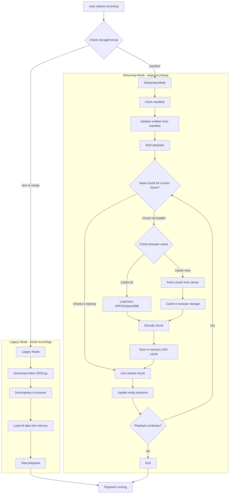
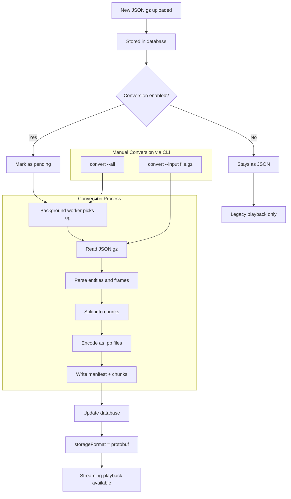

# Streaming Architecture

This document describes the playback and conversion flows for large recording support.

## Recording ingestion

With streaming enabled, recording follows `addon → extension WebSocket proxy → web`.
The extension parses addon commands into the shared `extension/v5/pkg/core` types
and forwards `pkg/streaming` envelopes. The web service owns entity history,
projectile and placed-object processing, statistics, serialization and storage.
The proxy does not create a local mission database or export/upload a mission file.

Enable it explicitly so existing installations keep their behavior:

Web `setting.json` (or `OCAP_STREAMING_ENABLED=true`):

```json
{"secret":"same-secret","streaming":{"enabled":true}}
```

Extension `ocap_recorder.cfg.json`, alongside the extension DLL/SO:

```json
{
  "api":{"serverUrl":"https://ocap.example/ocap","apiKey":"same-secret","uploadTimeout":"10m"},
  "storage":{"type":"websocket"}
}
```

The extension connects to `/ocap/api/v1/stream` in this example. Its build must
include the enabled WebSocket factory; older extension builds reject this storage
type even though they contain a WebSocket backend. `uploadTimeout` also controls
the proxy's wait for the final save acknowledgement. Memory recording remains
the extension default, and streaming remains disabled by default on the web.

The receiver supports all 28 message types in the current shared protocol,
including entity deletion, sectors, mission focus, radio, ACE medical events and
placed objects, as well as the original soldiers, vehicles, markers, combat,
general/chat events, telemetry and time records. Extension frames are one-based;
the current proxy declares `frameBase: 1` at mission start. The receiver converts
those frames, including snapshot `diffOf` references, to playback's zero-based
timeline. Older clients that omit the declaration keep their zero-based frames,
legacy marker end sentinel and projectile trajectory field name. Unknown future
message types are logged and skipped.

Each accepted mission gets one unique storage key, used for its database row,
v2 directory and legacy `.json.gz` backup. At mission end the web writes:

- Native **v2 protobuf** metadata and chunks, retaining the richer entity states,
  telemetry, mission metadata, radio/ACE events, placed objects and focus ranges.
  Chunks store state changes and a boundary seed so seeking requires only the
  requested chunk. Late messages amend their original chunk; empty timeline spans
  still have addressable chunk files.
- Player snapshot sidecars using the existing `snapshots/<unitId>.pb` format and
  endpoint, keeping large inventories out of the startup manifest. Older v2 files
  with inline snapshots remain readable.
- A **v1 JSON.gz backup** for legacy playback, downloads and fallback conversion.
  Existing uploads, v1 conversion, schema-v1 protobuf and JSON playback retain
  their existing paths. Legacy conversion never overwrites a native v2 recording.

An end-mission acknowledgement is sent only after the recording and operation
are saved. Direct v2 output is already finalized and needs no conversion job.
If v2 writing fails, a successful legacy backup becomes the operation's source
and follows the existing conversion setting. A failed save is reported by closing
the connection without a success acknowledgement, and the row is marked failed.

### Resume after a network failure

Producers that declare `protocolVersion: 2` in `start_mission` get lossless
recovery from network failures. Older producers keep the behavior described in
the next section.

- `start_mission` carries a `missionId` (a random UUID per recording) and a
  `producerId` (a random UUID per extension process). Every envelope carries a
  `seq`, starting with 1 for `start_mission`.
- The server acknowledges `start_mission` with `protocolVersion: 2`, and then
  acknowledges received envelopes cumulatively (`{"type":"ack","seq":N}`) every
  `streaming.ackInterval` and during bursts. The extension holds every envelope
  in memory until it is acknowledged.
- When the connection drops, the session stays registered under its mission id
  for `streaming.resumeGrace`. The extension keeps recording, reconnects, and
  sends `resume`. The server answers `resume_ok` with the last `seq` it holds,
  and the extension resends everything after it. Envelopes keep their capture
  frames, so resent data lands on its original frames. Duplicates are ignored.
- If the server no longer holds the mission (`resume_unknown`, for example after
  a web restart), the extension starts a new segment: it sends `start_mission`
  again followed by every envelope the server never acknowledged. The skipped
  numbers mark the new recording `partial`.
- If the mission was already saved but the `end_mission` acknowledgement was
  lost, the server answers `resume_completed` instead.
- A connection that resumes a mission closes any older connection still bound to
  it, such as a half-open socket. The extension also abandons a socket whose
  written envelopes stay unacknowledged for 20 seconds.
- Sessions are keyed only by mission id, so any number of game servers can stream
  to one web server. Only a session of the same producer is affected by a new
  `start_mission`: its earlier mission is saved as `partial` at once instead of
  waiting for the grace period.
- A session not resumed within the grace period is saved with `partial` appended
  to its tags.

| Setting | Default | Meaning |
|---|---|---|
| `streaming.resumeGrace` | `5m` | How long a disconnected mission waits for its producer |
| `streaming.ackInterval` | `1s` | How often received envelopes are acknowledged |
| `streaming.maxSessions` | `0` | Missions ingested at once; `0` = no limit |

Each session holds its mission in memory until it is saved, so many game
servers resending missions in full after a web restart can add up.
`maxSessions` bounds that. A refused `start_mission` closes the connection;
the producer keeps its data and retries with backoff. Resuming or repeating
the start of a mission already admitted needs no new slot. The live duration
and player count of a streaming recording are written to the database at most
every 15 seconds per mission.

The extension holds unacknowledged envelopes in memory (256 MiB by default) and
spools every envelope of the mission to disk until the mission is saved. During
a long outage, memory keeps the newest envelopes and the rest are resent from
the spool. When the server answers `resume_unknown` (after a web restart, or a
return past the grace period), the extension resends the whole mission from the
spool. The server then holds a complete recording, and on `end_mission` it
deletes the partial segments it had saved under the same mission id: rows and
files. A replay that still has a numbering gap, for example because the spool
hit its disk limit, keeps the earlier segments.

The mission id is stored with each streamed operation (`stream_mission_id`,
migration 15), together with whether `end_mission` saved it (`stream_ended`).
That record outlives a restart, so a producer whose `end_mission`
acknowledgement was lost still gets `resume_completed`, not a duplicate.

At startup, recordings still marked `streaming` belong to sessions the previous
process lost. They are marked `failed` instead of staying live forever. A
producer that returns replaces them with its full resend.

Without a spool (`spoolDir` empty) a full memory buffer refuses envelopes, and
the gap marks the recording partial, as does a resend after the server lost the
mission.

**Game server crashes.** The spool stays on disk when the game server
crashes. The next extension process resends the mission from it:
1. It resumes as the crashed process' producer id, read from the spooled
   `start_mission`. The server therefore continues a session still waiting in
   its grace period, or takes the whole mission with `resume_unknown`.
2. It then sends an `end_mission` with `"interrupted": true`.

The server saves such a recording with `partial` appended to its tags. It
still replaces the earlier partial segments when nothing is missing. Missions
whose save was never confirmed are recovered the same way, with their own
`end_mission`.

### Legacy producers

For producers without `protocolVersion: 2`, disconnecting without `end_mission`,
including an addon/extension crash or a normal WebSocket close, finalizes
received data and appends `partial` to the mission's existing tags. Repeated
starts cannot silently discard an active mission. Their reconnect starts a new
recording segment.

The session retains history in web memory for its legacy backup. A web process
crash is not the same as a producer disconnect and does not guarantee a finalized
backup; this protocol does not yet include a durable ingestion journal.

### Verification

Run `go test ./...` and the UI typecheck, tests, lint and build normally. The
ingestion tests cover every shared message type, both output formats, late frames,
gaps, snapshot sidecars, failed finalization and legacy fallback. The companion
extension also has an opt-in test using its real WebSocket backend:

```sh
OCAP_TEST_WEB_URL=http://127.0.0.1:5000 OCAP_TEST_WEB_SECRET=same-secret \
  go test ./internal/storage/websocket -run 'TestWebIngestionIntegration|TestWebResumeIntegration' -count=1 -v
```

Use a disposable web database/data directory with streaming enabled for that test.
`TestWebResumeIntegration` routes the extension through a proxy that it cuts three
times mid-mission, and expects one complete, non-partial recording.

## Playback Flow



## Conversion Flow



## Browser Caching

The browser uses a two-tier caching system:

1. **Memory Cache (LRU)**: Up to 3 chunks kept in RAM for instant access
2. **Persistent Cache (OPFS/IndexedDB)**: Chunks saved to browser storage for future sessions

This allows:
- Smooth playback without re-downloading chunks
- Seeking to previously viewed sections instantly
- Reduced server load on repeat viewings
