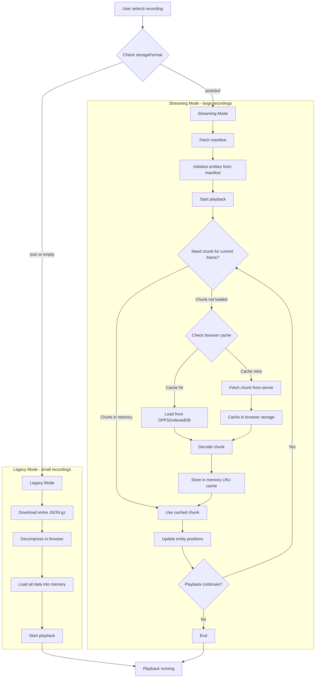
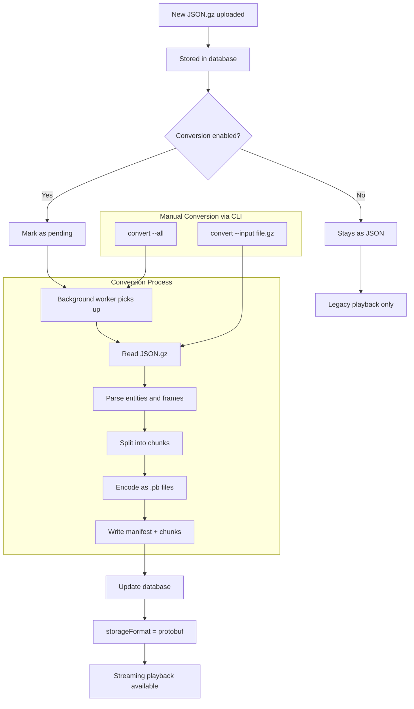

# Streaming Architecture

This document describes the playback and conversion flows for large recording support.

## Recording ingestion

With streaming enabled, recording follows `addon → extension WebSocket proxy → web`.
The extension parses addon commands into the shared `extension/v5/pkg/core` types
and forwards `pkg/streaming` envelopes. The web service owns entity history,
projectile and placed-object processing, statistics, serialization and storage.
The proxy does not create a local mission database or export/upload a mission file.

Enable it explicitly so existing installations keep their behavior:

Web `setting.json` (or `OCAP_STREAMING_ENABLED=true`):

```json
{"secret":"same-secret","streaming":{"enabled":true}}
```

Extension `ocap_recorder.cfg.json`, alongside the extension DLL/SO:

```json
{
  "api":{"serverUrl":"https://ocap.example/ocap","apiKey":"same-secret","uploadTimeout":"10m"},
  "storage":{"type":"websocket"}
}
```

The extension connects to `/ocap/api/v1/stream` in this example. Its build must
include the enabled WebSocket factory; older extension builds reject this storage
type even though they contain a WebSocket backend. `uploadTimeout` also controls
the proxy's wait for the final save acknowledgement. Memory recording remains
the extension default, and streaming remains disabled by default on the web.

The receiver supports all 28 message types in the current shared protocol,
including entity deletion, sectors, mission focus, radio, ACE medical events and
placed objects, as well as the original soldiers, vehicles, markers, combat,
general/chat events, telemetry and time records. Extension frames are one-based;
the current proxy declares `frameBase: 1` at mission start. The receiver converts
those frames, including snapshot `diffOf` references, to playback's zero-based
timeline. Older clients that omit the declaration keep their zero-based frames,
legacy marker end sentinel and projectile trajectory field name. Unknown future
message types are logged and skipped.

Each accepted mission gets one unique storage key, used for its database row,
v2 directory and legacy `.json.gz` backup. At mission end the web writes:

- Native **v2 protobuf** metadata and chunks, retaining the richer entity states,
  telemetry, mission metadata, radio/ACE events, placed objects and focus ranges.
  Chunks store state changes and a boundary seed so seeking requires only the
  requested chunk. Late messages amend their original chunk; empty timeline spans
  still have addressable chunk files.
- Player snapshot sidecars using the existing `snapshots/<unitId>.pb` format and
  endpoint, keeping large inventories out of the startup manifest. Older v2 files
  with inline snapshots remain readable.
- A **v1 JSON.gz backup** for legacy playback, downloads and fallback conversion.
  Existing uploads, v1 conversion, schema-v1 protobuf and JSON playback retain
  their existing paths. Legacy conversion never overwrites a native v2 recording.

An end-mission acknowledgement is sent only after the recording and operation
are saved. Direct v2 output is already finalized and needs no conversion job.
If v2 writing fails, a successful legacy backup becomes the operation's source
and follows the existing conversion setting. A failed save is reported by closing
the connection without a success acknowledgement, and the row is marked failed.

Disconnecting without `end_mission`, including an addon/extension crash or a
normal WebSocket close, finalizes received data and appends `partial` to the
mission's existing tags. Repeated starts cannot silently discard an active mission.
The extension's reconnect starts a new recording segment; the current protocol
does not replay a complete entity history or provide lossless network recovery.
The session retains history in web memory for its legacy backup. A web process
crash is not the same as a producer disconnect and does not guarantee a finalized
backup; this protocol does not yet include a durable ingestion journal.

### Verification

Run `go test ./...` and the UI typecheck, tests, lint and build normally. The
ingestion tests cover every shared message type, both output formats, late frames,
gaps, snapshot sidecars, failed finalization and legacy fallback. The companion
extension also has an opt-in test using its real WebSocket backend:

```sh
OCAP_TEST_WEB_URL=http://127.0.0.1:5000 OCAP_TEST_WEB_SECRET=same-secret \
  go test ./internal/storage/websocket -run TestWebIngestionIntegration -count=1 -v
```

Use a disposable web database/data directory with streaming enabled for that test.

## Playback Flow



## Conversion Flow



## Browser Caching

The browser uses a two-tier caching system:

1. **Memory Cache (LRU)**: Up to 3 chunks kept in RAM for instant access
2. **Persistent Cache (OPFS/IndexedDB)**: Chunks saved to browser storage for future sessions

This allows:
- Smooth playback without re-downloading chunks
- Seeking to previously viewed sections instantly
- Reduced server load on repeat viewings
